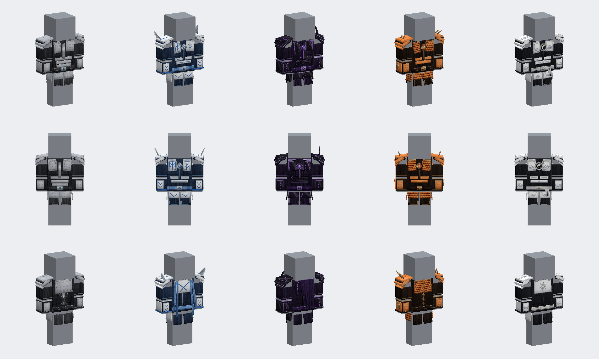
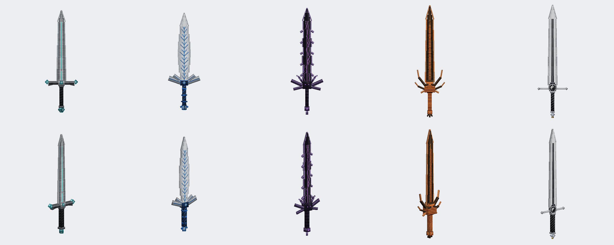

# 装备与武器 GeckoLib 模型

当前为 v4。五件胸甲和五把剑均为 GeckoLib 模型，在穿戴、手持、物品栏、掉落和物品展示框中显示立体模型。物品 ID、配方、属性、耐久和技能效果保持不变。原有平面图标保留，用作破坏粒子贴图。

v4 按用户要求全部重做为轻甲：贴身的软甲内衬上覆盖薄甲片，不使用厚重的大块护肩和板甲。制作顺序为神威、龙源、暗源、灵源、秘源，每个系列先做胸甲，再做同色系的剑。

## 设计

| 系列 | 主色 | 胸甲 | 剑 |
| --- | --- | --- | --- |
| 神威 | 黑白 | 黑色绗缝软甲、白色珐琅薄甲、银边；胸前太极护心镜，少量金色点缀 | 神威天罚：白色细长剑身、黑色血槽、太极护手 |
| 龙源 | 橙光 | 深铜色皮甲、橙色鳞片胸甲、发光橙色纹路；后掠小角、背部背鳍、龙眼宝石 | 始源龙剑：深铜剑身、橙色发光刃口、龙首护手 |
| 暗源 | 黑紫 | 黑漆薄甲、紫色虚空裂纹；左肩弯角、背部半幅残破披风、虚空宝石 | 暗源之剑：黑色锯齿剑身、紫色裂纹与刃口 |
| 灵源 | 蓝银 | 银色薄甲、蓝色珐琅叶脉镶嵌；肩部羽片、背部双飘带、蓝晶之心 | 灵源秘剑：银色叶形剑身、蓝色叶脉 |
| 秘源 | 灰银 | 灰钢铆钉甲、深灰内衬、银色铆钉与交叉背带；一颗青色秘源晶石点缀 | 秘源剑：灰银钢剑身、少量青色晶石 |

胸甲包含软甲内衬、胸甲片、肋甲、腹甲、腰带、背甲、护肩、前臂护甲和腿裙；腿裙绑定在腿部骨骼上，随步态摆动。

预览（离线渲染，不是游戏截图）：





## 文件

| 内容 | 路径 |
| --- | --- |
| 胸甲几何 | `assets/sourceofmystery/geo/armor/<id>.geo.json` |
| 胸甲贴图与发光遮罩 | `textures/armor/<id>.png`、`<id>_glowmask.png` |
| 剑几何 | `geo/item/<剑id>.geo.json` |
| 剑贴图与发光遮罩 | `textures/gear/<剑id>.png`、`<剑id>_glowmask.png` |
| 物品显示变换 | `models/item/gear_chestplate_display.json`、`gear_sword_display.json` |

胸甲 id 与护甲材质名称一致：`mystery`、`spirit_source`、`dark_source`、`origin_dragon`、`divine_blessing`。

代码位于 `com.sourceofmystery.client.gear`：`GearArmorRenderer` 渲染穿戴模型，`GearItemRenderer` 渲染物品模型，`GearClient` 只在客户端创建渲染器。`MysteryChestplateItem` 与 `MysterySwordItem` 实现 `GeoItem`。神威天佑继续使用 `DivineBlessingArmorRenderer`，保留黑白流光，并新增发光遮罩层。

## 生成与编辑

模型和贴图由 `tools/gear/` 中的脚本生成，需要 Python 3、NumPy、SciPy 与 Pillow。在仓库根目录运行：

```text
python tools/gear/armors.py
python tools/gear/divine_blessing.py
python tools/gear/swords.py
```

可只生成单件，例如 `python tools/gear/swords.py dark_source_sword`。

| 脚本 | 作用 |
| --- | --- |
| `forge3d.py` | 部件、骨骼、逐面 UV 打包、导出 geo.json 与贴图 |
| `paint.py` | 材质（玉石、金属、漆面、布料、鳞片、晶石、发光）与矢量纹样（祥云、回纹、太极、八卦、日芒、叶脉、符文） |
| `kit.py` | 骨骼模板与剑的通用部件 |
| `light.py` | 轻甲通用部件：内衬、胸甲片、护肩、前臂护甲、腰带、腿裙 |
| `armors.py`、`divine_blessing.py`、`swords.py`、`sword_designs.py` | 各件装备的设计 |
| `preview.py`、`sheet.py` | 离线预览与对比图 |
| `bb_import.js`、`review.js` | 通过 Blockbench MCP 导入审阅，可保存为 `.bbmodel` |

剑柄由 `kit.lengthen_hilt` 统一加长 2.8 像素，使握把填满手掌并露出剑首。第三人称手持变换把握把中点（几何 y = -4）放在手掌中心，剑身向前上方倾斜 25 度。

每个可见面都有独立 UV 区域，按实际尺寸绘制，因此贴图不重复平铺。设计脚本中的旋转按几何空间右手系书写，`forge3d.Model.box` 会换算为 GeckoLib 文件格式。

## 验证

`gradlew build` 编译通过。客户端检查使用隔离世界，主音量为 0：

```text
gradlew runClient -PgearCheck
```

截图输出到 `build/gear-client-check/screenshots/`，覆盖物品栏、物品展示框、掉落物、第一人称手持、四件胸甲的第三人称前后视角、盔甲架手持剑的侧视与近景（`14-grip-side.png`、`15-grip-close.png`），以及完整的登神 CG 与神威天佑穿戴效果。
