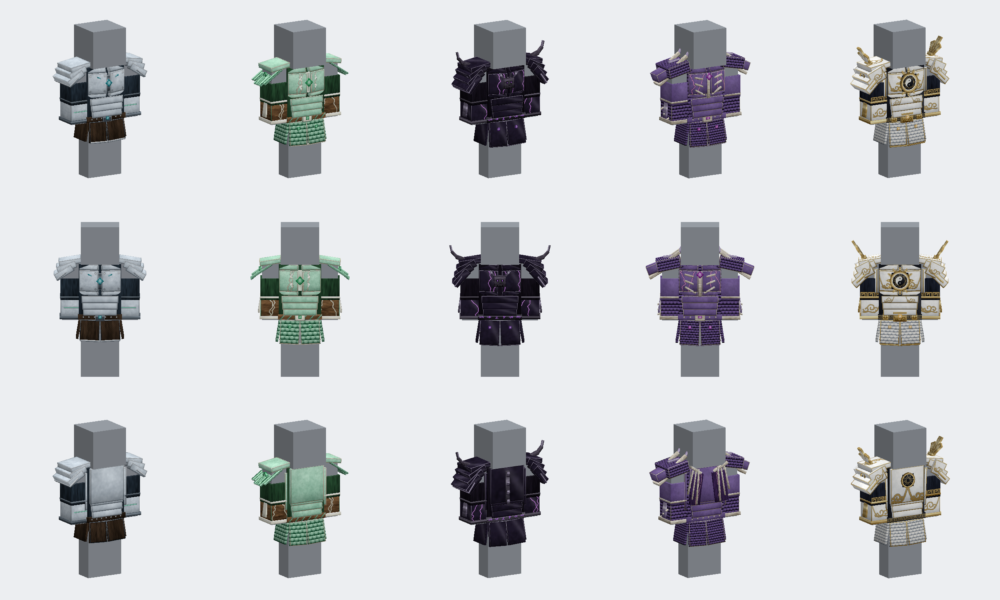
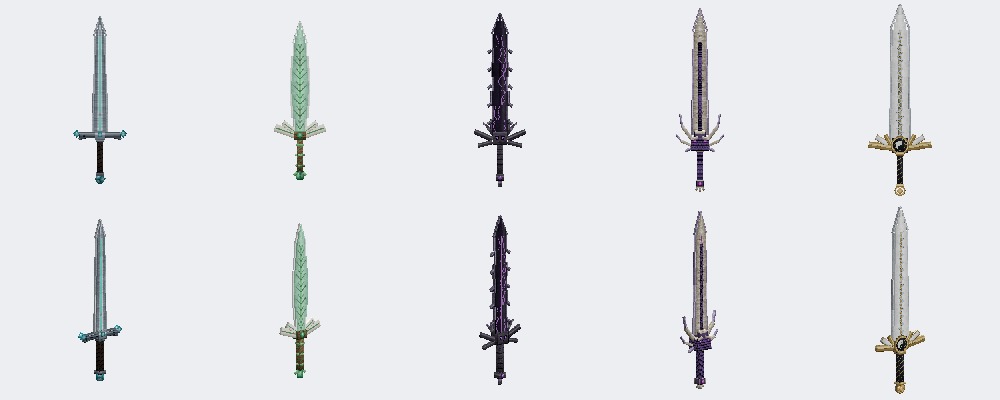

# 装备与武器 GeckoLib 模型 v3

五件胸甲和五把剑全部改为 GeckoLib 模型。胸甲在穿戴、手持、物品栏、掉落和物品展示框中都显示立体模型；剑在所有位置显示立体模型。物品 ID、配方、属性、耐久和技能效果保持不变。原有平面图标保留，用作破坏粒子贴图。

此前 `drafts/equipment_gecko/` 中被否定的草稿没有被使用。v3 按装备名称和等级重新设计，贴图为程序绘制的高分辨率材质，不使用像素风格元素。

## 设计

| 等级 | 胸甲 | 剑 | 主题 |
| --- | --- | --- | --- |
| 1 | 秘源甲 | 秘源剑 | 回火蓝钢、青色秘源矿晶 |
| 2 | 灵源秘甲 | 灵源秘剑 | 碧玉叶甲、象牙叶脉、翠晶之心 |
| 3 | 暗源之甲 | 暗源之剑 | 黑曜甲片、紫色虚空裂纹、凋零骷髅、弯角护肩 |
| 4 | 始源龙甲 | 始源龙剑 | 龙鳞胸甲、龙首护肩、背部收拢龙翼、龙骨剑身 |
| 5 | 神威天佑 | 神威天罚 | 白玉金纹天将甲、太极日轮护心镜、羽冠护肩；天罚剑为白玉剑身、金色雷纹 |

等级越高，部件数量、轮廓复杂度和发光细节越多。胸甲包含胸铠、背甲、护肩、臂铠和两侧腿裙；腿裙绑定在腿部骨骼上，随步态摆动。

预览（离线渲染，不是游戏截图）：





## 文件

| 内容 | 路径 |
| --- | --- |
| 胸甲几何 | `assets/sourceofmystery/geo/armor/<id>.geo.json` |
| 胸甲贴图与发光遮罩 | `textures/armor/<id>.png`、`<id>_glowmask.png` |
| 剑几何 | `geo/item/<剑id>.geo.json` |
| 剑贴图与发光遮罩 | `textures/gear/<剑id>.png`、`<剑id>_glowmask.png` |
| 物品显示变换 | `models/item/gear_chestplate_display.json`、`gear_sword_display.json` |

胸甲 id 与护甲材质名称一致：`mystery`、`spirit_source`、`dark_source`、`origin_dragon`、`divine_blessing`。

代码位于 `com.sourceofmystery.client.gear`：`GearArmorRenderer` 渲染穿戴模型，`GearItemRenderer` 渲染物品模型，`GearClient` 只在客户端创建渲染器。`MysteryChestplateItem` 与 `MysterySwordItem` 实现 `GeoItem`。神威天佑继续使用 `DivineBlessingArmorRenderer`，保留黑白流光，并新增发光遮罩层。

## 生成与编辑

模型和贴图由 `tools/gear/` 中的脚本生成，需要 Python 3、NumPy、SciPy 与 Pillow。在仓库根目录运行：

```text
python tools/gear/armors.py
python tools/gear/divine_blessing.py
python tools/gear/swords.py
```

可只生成单件，例如 `python tools/gear/swords.py dark_source_sword`。

| 脚本 | 作用 |
| --- | --- |
| `forge3d.py` | 部件、骨骼、逐面 UV 打包、导出 geo.json 与贴图 |
| `paint.py` | 材质（玉石、金属、漆面、布料、鳞片、晶石、发光）与矢量纹样（祥云、回纹、太极、八卦、日芒、叶脉、符文） |
| `kit.py` | 胸甲和剑的通用部件 |
| `armors.py`、`divine_blessing.py`、`swords.py`、`sword_designs.py` | 各件装备的设计 |
| `preview.py`、`sheet.py` | 离线预览与对比图 |
| `bb_import.js`、`review.js` | 通过 Blockbench MCP 导入审阅，可保存为 `.bbmodel` |

每个可见面都有独立 UV 区域，按实际尺寸绘制，因此贴图不重复平铺。设计脚本中的旋转按几何空间右手系书写，`forge3d.Model.box` 会换算为 GeckoLib 文件格式。

## 验证

`gradlew build` 编译通过。客户端检查使用隔离世界，主音量为 0：

```text
gradlew runClient -PgearCheck
```

截图输出到 `build/gear-client-check/screenshots/`，覆盖物品栏、物品展示框、掉落物、第一人称手持、四件胸甲的第三人称前后视角，以及完整的登神 CG 与神威天佑穿戴效果。
