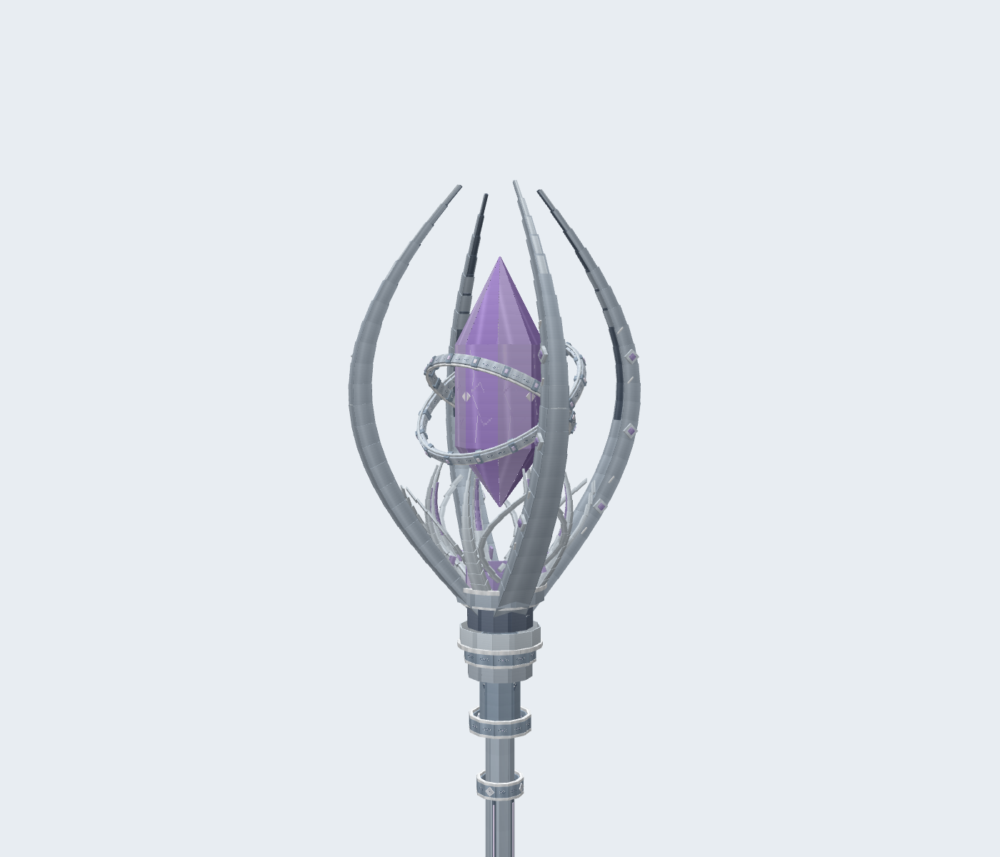

# 超位权杖模型 v2

v2 重做了权杖的几何、材质与晶核动画。沿用银色长杖、淡紫色晶体、四瓣杖冠和交错双环的造型。

## 模型细节

- 杖冠使用逐段收尖的分层银瓣，包含内侧凹槽、亮边、凸起箭纹和紫色镶石。
- 晶核下方增加八瓣镂空花萼、弧形卷叶及分层金属底座。
- 中央晶体使用八个侧面与十六个尖端切面；保留独立旋转、浮动及施法伸缩。双环含包边、刻纹、卡扣和发光节点。
- 杖身增加连续符文槽、四向宝石镶嵌、分段套箍；握柄使用连续展开的编织纹理与立体银丝，尾端增加四瓣金属护饰。
- 几何从 140 个元素增加到 1626 个立方体或平面，使用 40 个骨骼。材质从 64 × 64 更新为 512 × 512，另有符文与晶核的发光遮罩。

以下图片直接由 Blockbench 渲染，使用浅色背景。



[完整模型](assets/staff-v2-full.png) · [握柄近景](assets/staff-v2-grip.png)

## 文件与重新生成

可编辑工程为 [dimension_breaker_staff.bbmodel](../tools/staff/dimension_breaker_staff.bbmodel)，包含嵌入材质和六段动画。工程内显示名称为 `dimension_breaker_staff_v2`，游戏资源名称保持 `dimension_breaker_staff`。

资源位于 `src/main/resources/assets/sourceofmystery/`：

| 路径 | 内容 |
| --- | --- |
| `geo/item/dimension_breaker_staff.geo.json` | GeckoLib 几何与骨骼 |
| `animations/item/dimension_breaker_staff.animation.json` | 待机、吟唱、裂地、悬浮、撕裂、时停动画 |
| `textures/item/dimension_breaker_staff.png` | 主材质 |
| `textures/item/dimension_breaker_staff_glowmask.png` | 局部发光遮罩 |

生成工具需要 Python 3 与 Pillow。在仓库根目录运行：

```text
python tools/staff/generate_assets.py
```

生成器定义了材质图块、几何构件与动画。它会更新游戏资源；修改生成器后，使用 [import_blockbench.js](../tools/staff/import_blockbench.js) 同步 Blockbench 工程。该导入脚本面向当前空项目或权杖项目，使用一个 Undo 操作重新创建骨骼、逐面 UV、材质和动画。

通过 Blockbench MCP 的 `risky_eval` 执行以下代码，其中 `root` 改为当前仓库的绝对路径：

```javascript
const root = 'I:/Other_Dev/SourceOfMystery';
Function('root', 'require', 'Undo', 'Cube', 'Group', 'Texture', 'Project',
    'Animation', 'AnimationCodec', 'Canvas',
    require('fs').readFileSync(root + '/tools/staff/import_blockbench.js', 'utf8'))
    (root, require, Undo, Cube, Group, Texture, Project, Animation, AnimationCodec, Canvas);
```

随后保存为 `tools/staff/dimension_breaker_staff.bbmodel`。尖端晶体使用透明裁切平面，兼容现有 GeckoLib 4 渲染路径。发光层采用 GeckoLib 的 `AutoGlowingGeoLayer`，对应[官方发光材质说明](https://github.com/bernie-g/geckolib/wiki/Emissive-Textures-%28Geckolib4%29)。

## 验证

使用 Java 17、Forge 1.20.1-47.4.20、GeckoLib 4.8.4。检查游戏几何与 Blockbench 重新导出的骨骼、坐标、逐面 UV 和六段动画，确认工程内嵌材质与游戏 PNG 一致。

客户端检查覆盖第一及第三人称持杖、五种施法姿势、法阵位置、时停与颜色恢复。第十五张截图新增无夜视效果的夜间检查，用于查看符文和晶核的局部发光。开发检查类不会进入发布 JAR。

```text
gradlew build
gradlew runClient -PstaffCheck
```

2026-11-01：构建与客户端检查成功，日志输出 `STAFF_CLIENT_OK frames=15`；已核对夜间截图中的晶体轮廓、裂纹与符文微光。发布 JAR 内的模型、动画和两张材质与当前源文件一致。

截图输出至 `build/staff-client-check/screenshots/`，本次日志为 `build/staff-v2-client-final.log`。原有功能规则与服务端测试记录见 [staff-v1.md](staff-v1.md)。
